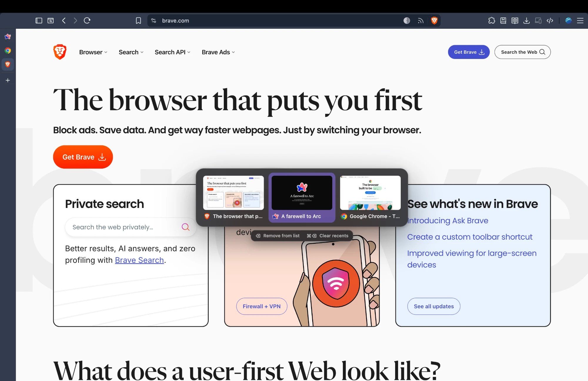

# controlTab

Ctrl+Tab that goes to your most recently used tabs instead of the next tab in the strip, with an
optional visual switcher in the style of Arc. For Chromium browsers such as Chrome and Brave.



## Install

The extension is not on the Chrome Web Store, so it is loaded from a folder:

1. Download it: on the GitHub page click **Code**, then **Download ZIP**, and unzip the file
   (or `git clone` the repository).
2. Open `chrome://extensions` and turn on **Developer mode** (top right).
3. Click **Load unpacked** and pick the unzipped folder, the one that contains `manifest.json`.
4. The settings open by themselves. Follow **Set it to Ctrl+Tab** there (one time only).

Keep the folder where it is, since the browser loads the extension from it. To update, replace
the files and click the reload icon on the extension's card.

## Binding Ctrl+Tab

Chrome's shortcut field refuses Ctrl+Tab, so the binding is set with a short command:

1. Open `chrome://extensions/shortcuts`.
2. Open the DevTools console on that page: Cmd+Option+J on a Mac, Ctrl+Shift+J elsewhere.
3. Paste the command shown in the controlTab settings (it contains your extension ID) and press
   Enter. If Chrome asks, type `allow pasting` first.

It looks like this:

```js
chrome.developerPrivate.updateExtensionCommand({ extensionId: "YOUR_ID", commandName: "forward", keybinding: "Ctrl+Tab" });
chrome.developerPrivate.updateExtensionCommand({ extensionId: "YOUR_ID", commandName: "backward", keybinding: "Ctrl+Shift+Tab" });
```

The binding survives restarts. To go back to Chrome's own Ctrl+Tab, clear the two shortcuts on the
shortcuts page or remove the extension.

## Settings

Click the toolbar icon (or open the extension's options).

- **Show the switcher**: hold Ctrl and tap Tab to move through your recent tabs with previews,
  release Ctrl to switch. A quick tap jumps straight to the last tab. Escape cancels, and you can
  also click a tab.
- **Switch directly**: each press jumps straight to the last tab you used, with no visual. Keep
  Ctrl held and tap Tab again to go further back.

Ctrl+Shift+Tab moves the other way in both modes.

## Recent tabs

The list starts empty every time the browser starts. A tab joins it once you have viewed it in the
current session, so tabs restored from last time or opened in the background stay out until you
visit them. Up to 10 tabs are shown, per window.

While the switcher is open:

- **Delete** (or Backspace) removes the highlighted tab from the list. The tab stays open, and
  comes back in the list the next time you visit it. The cross that appears on a tab when you
  hover it does the same.
- **Cmd+Delete** empties the whole list. So does **Clear recents** under the switcher, and
  **Clear recent tabs** in the settings.

In the settings you can make Delete and the cross close the tab itself instead. A tab closed
that way can be brought back with Cmd+Shift+T as usual.

## Good to know

- On pages extensions cannot touch (new tab page, `chrome://` pages, the Web Store) and while the
  address bar has the focus, the shortcut switches directly, without the switcher.
- With nothing else in the list yet, the shortcut shows only the current tab and does nothing.
- A tab shows its icon until its preview has been taken, which happens when you view it.

## Permissions

- **All sites**: needed to draw the switcher inside the current page and to take the previews.
- **Tabs, favicon**: titles and icons for the switcher.
- **Storage**: your setting, plus the recent list and previews (kept in memory for the session only).

Nothing leaves your browser: the extension makes no network requests.

## Files

- `manifest.json`: extension definition.
- `background.js`: recency tracking, previews, shortcut handling.
- `switcher.js`: the switcher drawn in the page, and key release detection.
- `options.html`, `options.js`: settings page and toolbar popup.
